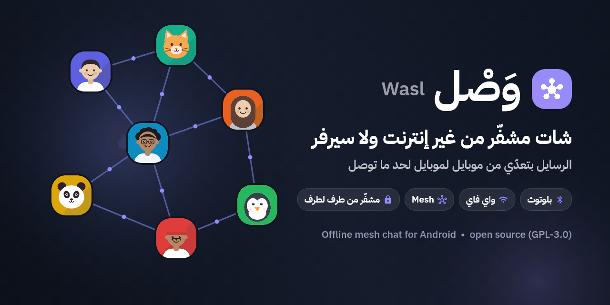
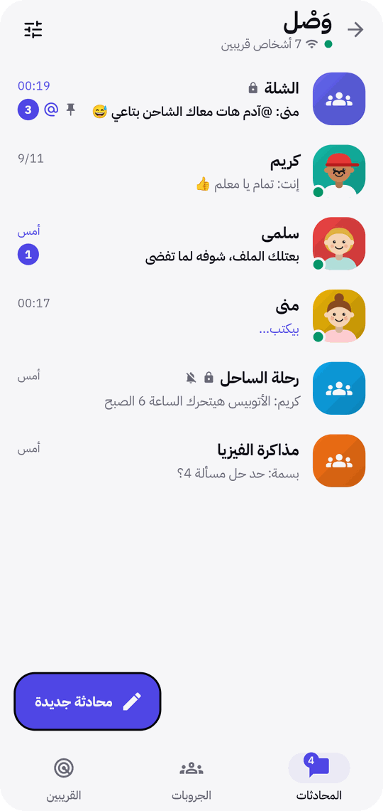
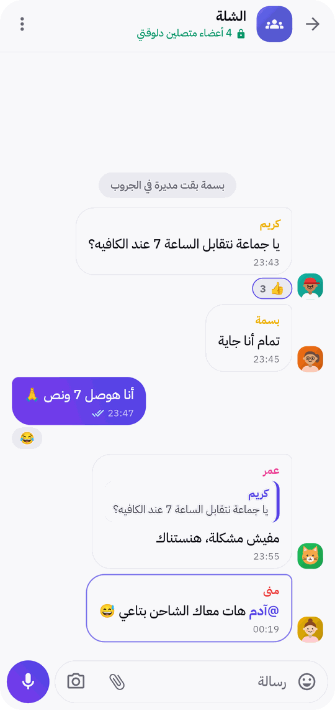
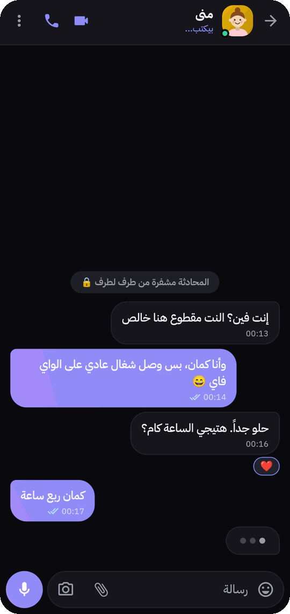
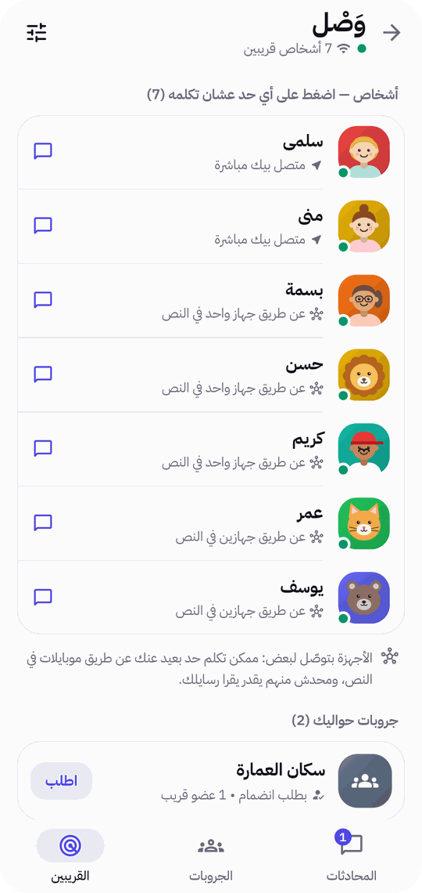
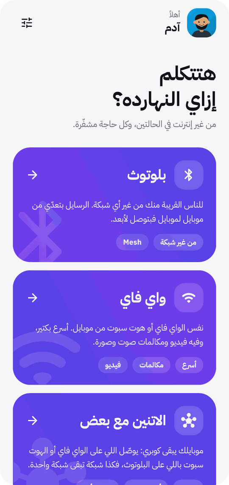
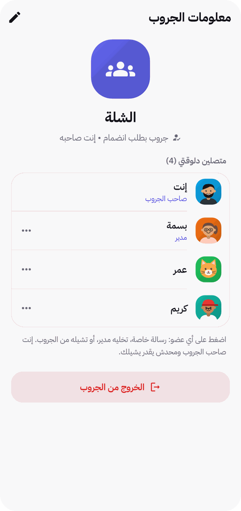
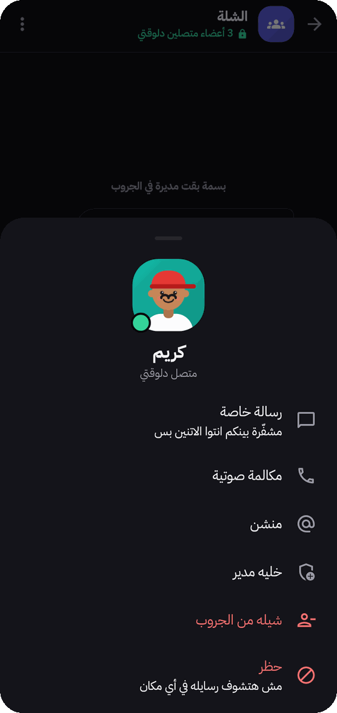
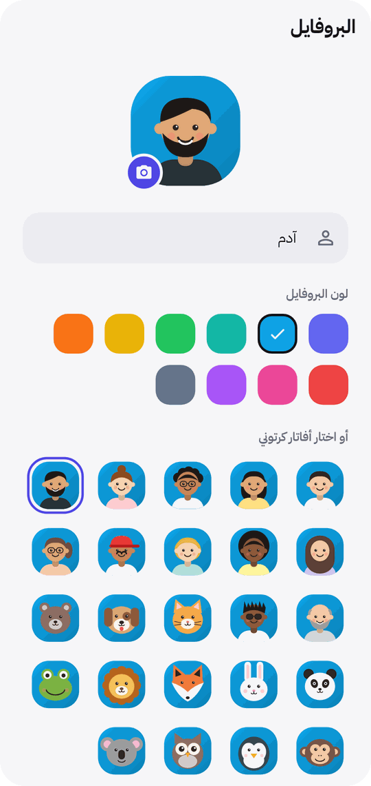

[English](README.md) | **العربية**

<p align="center">
  
</p>

<p align="center">
  <a href="https://github.com/AdamG00D/Wasl/actions/workflows/ci.yml"></a>
  <a href="https://github.com/AdamG00D/Wasl/releases/latest"></a>
  <a href="LICENSE"></a>
  
  
</p>

# وَصْل — Wasl

شات لأندرويد شغال **من غير إنترنت ومن غير سيرفر**: الموبايلات اللي جنب بعض بتكلم بعض مباشرة بالبلوتوث أو على نفس
الواي فاي / الهوت سبوت، وكل موبايل بيوصّل رسايل غيره (**Mesh**)، فرسالتك توصل لناس أبعد من مدى موبايلك.
الشات الخاص مشفّر من طرف لطرف تلقائياً — من غير حساب ولا رقم موبايل ولا كلمة سر.

معمول للأماكن اللي النت فيها واقع أو زحمة أو مش آمن: رحلات، حفلات، جامعات، تجمعات، انقطاع الكهربا. الواجهة
عربي (والإنجليزي جاي).

## صور من التطبيق

<table>
  <tr>
    <td align="center"><br><sub>المحادثات والجروبات</sub></td>
    <td align="center"><br><sub>جروب: تفاعلات وردود ومنشن</sub></td>
    <td align="center"><br><sub>شات خاص (الوضع الغامق)</sub></td>
    <td align="center"><br><sub>الناس والجروبات القريبة</sub></td>
  </tr>
</table>

<details>
<summary>صور أكتر</summary>
<br>
<table>
  <tr>
    <td align="center"><br><sub>بلوتوث أو واي فاي أو الاتنين</sub></td>
    <td align="center"><br><sub>صاحب الجروب والمديرين</sub></td>
    <td align="center"><br><sub>الضغط على عضو</sub></td>
    <td align="center"><br><sub>البروفايل والأفاتارات الكرتونية</sub></td>
  </tr>
</table>
</details>

## المميزات

- **من غير إنترنت ولا سيرفر ولا حساب**: اسم وأفاتار بس، وهويتك مفتاح بيتولّد على موبايلك.
- **تلات طرق للاتصال**: بلوتوث (من غير أي شبكة)، واي فاي / هوت سبوت (أسرع، وفيه فيديو ومكالمات)، أو
  **الاتنين مع بعض** فموبايلك يبقى كوبري بين شبكة الواي فاي والناس اللي على البلوتوث.
- **Mesh**: الرسايل بتعدّي على موبايلات تانية (لحد 6 قفزات)، واللي في النص ميقدروش يقروا الشات الخاص.
- **شات خاص** مشفّر من طرف لطرف تلقائياً، ورمز أمان اختياري تتأكدوا بيه من بعض.
- **جروبات**: عام، بكلمة سر، أو بطلب انضمام — بصاحب ومديرين يقدروا يشيلوا أعضاء ويمسحوا رسايل.
- **كل اللي متعود عليه في تطبيقات الشات**: صور، ملفات، فويس، رد، تعديل، حذف عند الكل، تفاعل بالإيموجي، منشن،
  تحويل، بحث، علامات القراءة، "بيكتب..."، ومكالمات صوت وفيديو على الواي فاي.
- **إشعارات** زي أي تطبيق شات، ومنها رد سريع، وكتم وتثبيت لكل محادثة.
- **الخصوصية هي الأساس**: المحادثات في الذاكرة بس إلا لو اخترت تحفظها، والمحفوظ متشفّر بمفتاح جوه Android
  Keystore. قفل برقم سري أو بصمة اختياري. مفيش تحليلات ولا إعلانات ولا أي اتصال بالإنترنت.

## التحميل

نزّل الـ APK من [آخر إصدار](https://github.com/AdamG00D/Wasl/releases/latest) (أندرويد 7 أو أحدث):

| الملف | لمين |
|---|---|
| `Wasl-<الإصدار>-arm64-v8a.apk` | **أغلب الموبايلات** (من 2017 وطالع) — لو مش متأكد اختار ده |
| `Wasl-<الإصدار>-armeabi-v7a.apk` | الموبايلات القديمة أو الرخيصة |
| `Wasl-<الإصدار>-x86_64.apk` | المحاكي وأجهزة Chromebook |
| `Wasl-<الإصدار>-universal.apk` | أي موبايل (حجمه أكبر) |

كل النسخ بنفس رقم الإصدار، فتقدر تحدّث من أي واحدة لأي واحدة. وتتأكد من الملفات بـ `sha256sum -c SHA256SUMS.txt`.

> وصل مش موجود على F-Droid: وضع البلوتوث معتمد على Google Nearby Connections، ودي جزء من خدمات Google Play.

## بيشتغل إزاي

```
 [موبايل A] ──واي فاي── [موبايل B] ──بلوتوث── [موبايل C] ──بلوتوث── [موبايل D]
     └────────── مشفّر من طرف لطرف: B و C بيوصّلوا بس ومبيقروش ──────────┘
```

كل موبايل بيعرّف نفسه للي جنبه، وبيعرف مين واصل له عن طريق مين، وبيعدّي الرسايل. الشات الخاص فوق ده كله
بمصافحة X25519 موثّقة، وكل رسالة متشفّرة AES-256-GCM. الجروبات بمفتاح مشترك، وأوامر الإدارة موثّقة لكل عضو
لوحده. البروتوكول كامل في [docs/PROTOCOL.md](docs/PROTOCOL.md)، وإيه اللي محمي وإيه اللي لأ في
[SECURITY.ar.md](SECURITY.ar.md).

## التشغيل من الكود

محتاج [Flutter](https://docs.flutter.dev/get-started/install) (stable، Dart ≥ 3.9) و JDK 17 أو أحدث.

```bash
flutter pub get
flutter analyze        # لازم: No issues found!
flutter test           # الشبكة، التشفير، الجروبات، الإدارة، التخزين، الواجهة — من غير موبايلات
flutter run            # على موبايل أندرويد (البلوتوث مبيشتغلش على المحاكي)
```

من غير مفتاح التوقيع المشروع بيتبني عادي وبيتوقّع بمفتاح الـ debug. الإصدارات الرسمية بتتبني بـ
`./scripts/build_release.sh`. وعشان تجرّب بجد محتاج موبايلين على نفس الواي فاي (أو واحد فاتح هوت سبوت)، أو
موبايلين بالبلوتوث جنب بعض.

## المشروع من جوه

| المكان | فيه إيه |
|---|---|
| `lib/mesh/` | وسايل الربط (واي فاي / بلوتوث / الاتنين) وموجّه الشبكة |
| `lib/features/chat/core/` | القناة المشفّرة، الجلسة، نقل الملفات |
| `lib/features/groups/` | الجروبات: المفاتيح، الجلسة، أوامر الإدارة |
| `lib/features/hub/chat_hub.dart` | بيربط كل حاجة: الشبكة، المحادثات، الحفظ، الإشعارات |
| `lib/core/` | التشفير، البروفايل، التخزين المشفّر، الإعدادات، الثيم |
| `android/…/kotlin/` | الإشعارات، الخدمة، Keystore، التشفير السريع، الضغط |
| `test/` | اختبارات بشبكة وهمية في الذاكرة (من غير موبايلات) |

## المساهمة والأمان

- عايز تساهم؟ اقرا [CONTRIBUTING.ar.md](CONTRIBUTING.ar.md).
- لقيت ثغرة؟ **متفتحش issue علني** — اتبع [SECURITY.ar.md](SECURITY.ar.md).
- التزم بـ [قواعد التعامل](CODE_OF_CONDUCT.ar.md).

## الترخيص

وصل برنامج حر تحت رخصة **GNU GPL v3.0 أو أحدث** — النص الكامل في [LICENSE](LICENSE).

Copyright © 2026 Adam Ghanem and Wasl contributors.

إذن إضافي (حسب البند 7 من GPLv3): مسموح تربط البرنامج ده بمكتبات Google Play Services (اللي Nearby Connections
جزء منها) وتوزّع الناتج، من غير ما ده يخلّي المكتبات دي خاضعة للرخصة.

الخط [IBM Plex Sans Arabic](https://github.com/IBM/plex) تحت رخصة SIL Open Font License 1.1.
