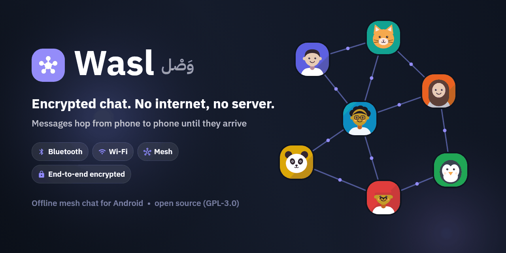
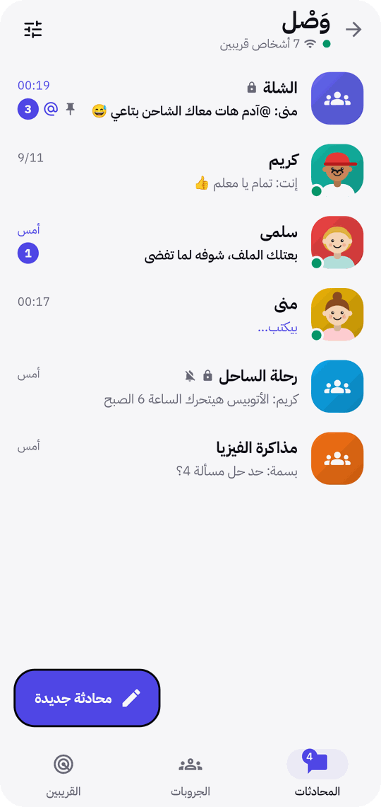
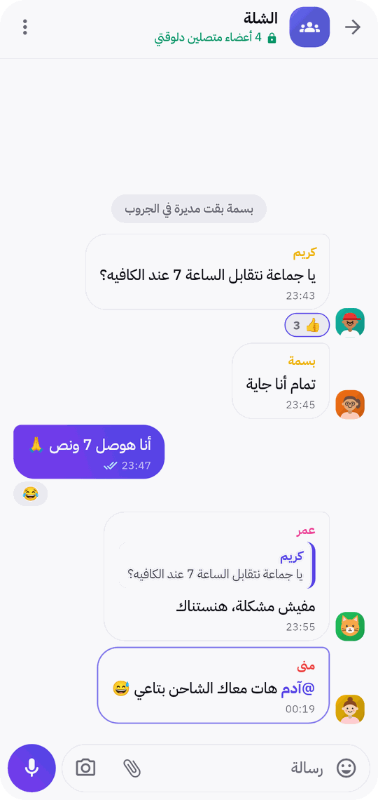
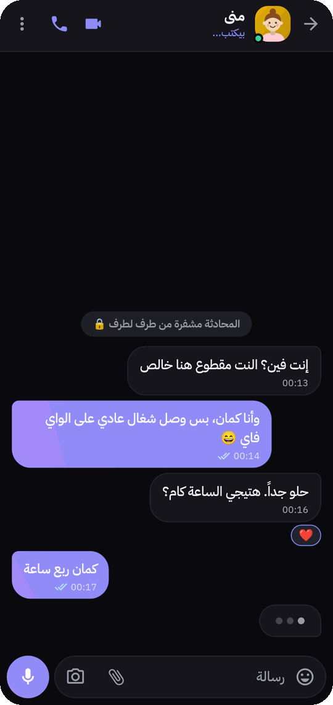
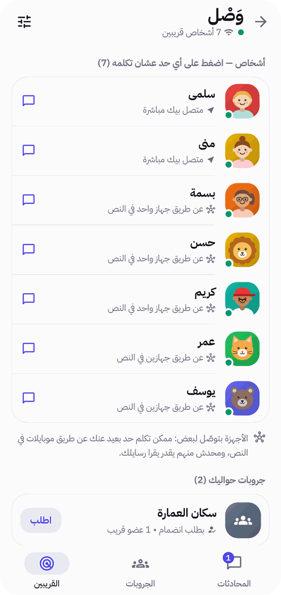
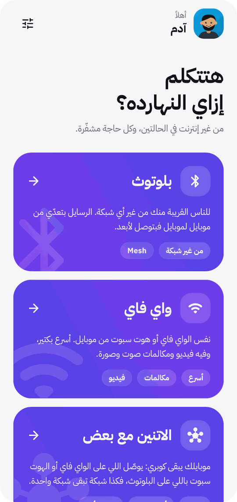
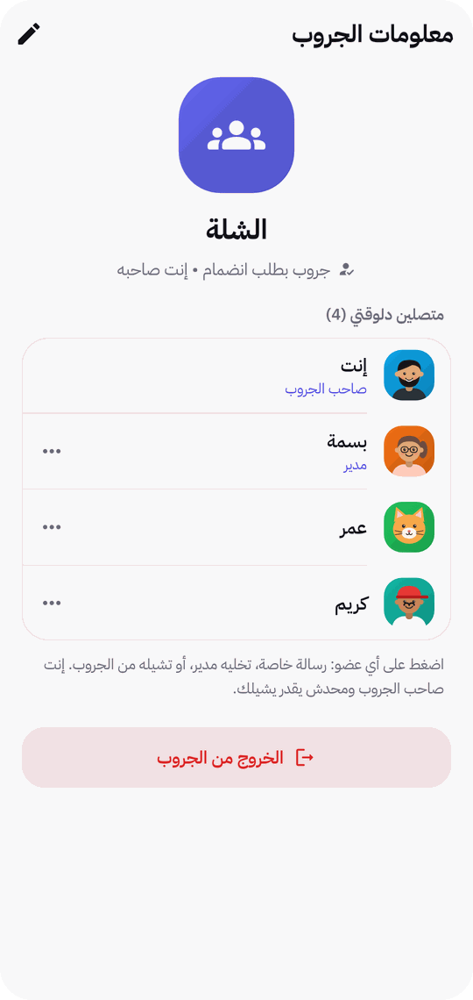
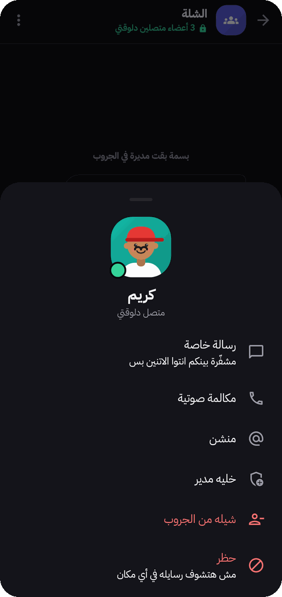
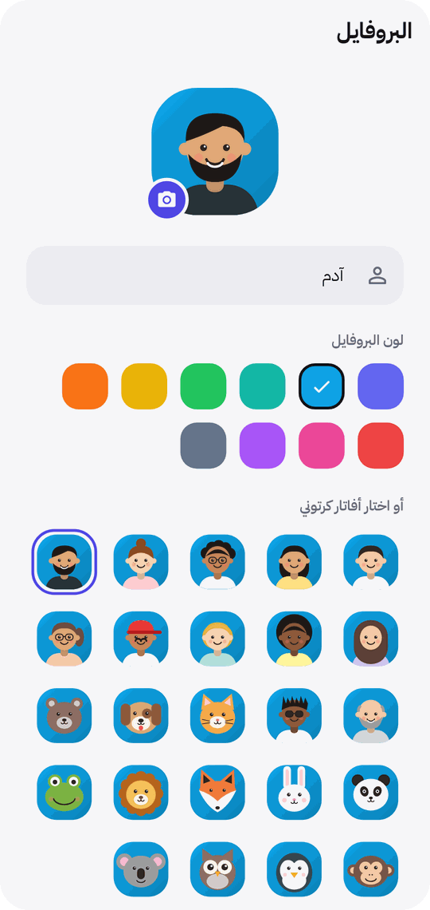

**English** | [العربية](README.ar.md)

<p align="center">
  
</p>

<p align="center">
  <a href="https://github.com/AdamG00D/Wasl/actions/workflows/ci.yml"></a>
  <a href="https://github.com/AdamG00D/Wasl/releases/latest"></a>
  <a href="LICENSE"></a>
  
  
</p>

# Wasl — وَصْل

**Wasl** ("connection" in Arabic) is a chat app for Android that works **with no internet and no server**. Phones
nearby talk directly over **Bluetooth** or the same **Wi-Fi / hotspot**, and relay messages for each other as a
**mesh**, so a message can reach someone well beyond your own phone's range. Private chats are end-to-end encrypted
automatically — no accounts, no phone numbers, no passwords.

Built for places where the network is down, overloaded or untrusted: protests, festivals, trips, campuses, power
cuts. The interface is in Arabic (English is planned).

## Screenshots

<table>
  <tr>
    <td align="center"><br><sub>Chats &amp; groups</sub></td>
    <td align="center"><br><sub>Group: reactions, replies, mentions</sub></td>
    <td align="center"><br><sub>Private chat (dark theme)</sub></td>
    <td align="center"><br><sub>Nearby people &amp; groups</sub></td>
  </tr>
</table>

<details>
<summary>More screenshots</summary>
<br>
<table>
  <tr>
    <td align="center"><br><sub>Bluetooth, Wi-Fi or both</sub></td>
    <td align="center"><br><sub>Group owner &amp; admins</sub></td>
    <td align="center"><br><sub>Tap a member</sub></td>
    <td align="center"><br><sub>Profile &amp; cartoon avatars</sub></td>
  </tr>
</table>
</details>

## Features

- **No internet, no server, no account** — a name and an avatar; your identity is a key generated on your phone.
- **Three ways to connect** — Bluetooth (no network at all), Wi-Fi / hotspot (faster, with video and calls), or
  **both at once**, which turns your phone into a bridge between a Wi-Fi network and people on Bluetooth.
- **Mesh** — messages hop through other phones (up to 6 hops); relays can't read private chats.
- **Private chats** — end-to-end encrypted automatically, with an optional safety code to verify each other.
- **Groups** — open, password-protected or join-by-request, with an owner and admins who can remove members and
  delete messages.
- **Everything you'd expect from a chat app** — photos, files, voice notes, replies, edits, delete for everyone,
  emoji reactions, @mentions, forwarding, search, read receipts, "typing…", voice and video calls over Wi-Fi.
- **Notifications** like a regular chat app, with quick reply; per-chat mute and pin.
- **Private by default** — chats are kept in memory only unless you choose to save them; saved chats are encrypted
  with a key held in Android Keystore. Optional PIN / fingerprint lock. No analytics, no ads, no network calls.

## Download

Get the APK from the [latest release](https://github.com/AdamG00D/Wasl/releases/latest) (Android 7.0+):

| File | For |
|---|---|
| `Wasl-<version>-arm64-v8a.apk` | **Most phones** (2017 and newer) — pick this if unsure |
| `Wasl-<version>-armeabi-v7a.apk` | Older or low-end phones |
| `Wasl-<version>-x86_64.apk` | Emulators and Chromebooks |
| `Wasl-<version>-universal.apk` | Any device (larger download) |

All variants share one version code, so you can switch between them when updating. Check downloads with
`sha256sum -c SHA256SUMS.txt`.

> Wasl is not on F-Droid: Bluetooth mode uses Google Nearby Connections, which is part of Google Play Services.

## How it works

```
 [phone A] ──Wi-Fi── [phone B] ──Bluetooth── [phone C] ──Bluetooth── [phone D]
     └──────────── end-to-end encrypted: B and C relay but can't read ────────────┘
```

Each phone announces itself to its neighbours, learns who is reachable through whom, and forwards frames it
receives. Private chats run an authenticated X25519 handshake on top and encrypt every message with AES-256-GCM.
Groups share a group key; admin commands are authenticated individually. The full protocol is in
[docs/PROTOCOL.md](docs/PROTOCOL.md), and what is and isn't protected is in [SECURITY.md](SECURITY.md).

## Build from source

Requires [Flutter](https://docs.flutter.dev/get-started/install) (stable, Dart ≥ 3.9) and JDK 17+.

```bash
flutter pub get
flutter analyze        # must report: No issues found!
flutter test           # mesh, encryption, groups, admin, storage, UI — no devices needed
flutter run            # on an Android phone (Bluetooth doesn't work in the emulator)
```

Without the release signing key the project still builds, signed with the debug key. Official releases are built
with `./scripts/build_release.sh`. To try it for real you need two phones on the same Wi-Fi (or one sharing a
hotspot), or two phones with Bluetooth next to each other.

## Project layout

| Path | What's there |
|---|---|
| `lib/mesh/` | Links (Wi-Fi, Bluetooth, both) and the mesh router |
| `lib/features/chat/core/` | Encrypted channel, chat session, file transfer |
| `lib/features/groups/` | Groups: keys, sessions, admin commands |
| `lib/features/hub/chat_hub.dart` | Ties it together: network, conversations, storage, notifications |
| `lib/core/` | Crypto, profile, encrypted storage, settings, theme |
| `android/…/kotlin/` | Notifications, background service, Keystore, native crypto, media compression |
| `test/` | Tests on an in-memory network (no phones needed) |

## Contributing & security

- Contributions are welcome — read [CONTRIBUTING.md](CONTRIBUTING.md).
- Found a vulnerability? **Don't open a public issue** — see [SECURITY.md](SECURITY.md).
- Please follow the [Code of Conduct](CODE_OF_CONDUCT.md).

## License

Wasl is free software under the **GNU General Public License v3.0 or later** — see [LICENSE](LICENSE).

Copyright © 2026 Adam Ghanem and Wasl contributors.

Additional permission under GPLv3 section 7: you may link this program with the Google Play Services libraries
(which include Nearby Connections) and distribute the result without those libraries becoming subject to this
license.

The [IBM Plex Sans Arabic](https://github.com/IBM/plex) font is licensed under the SIL Open Font License 1.1.
